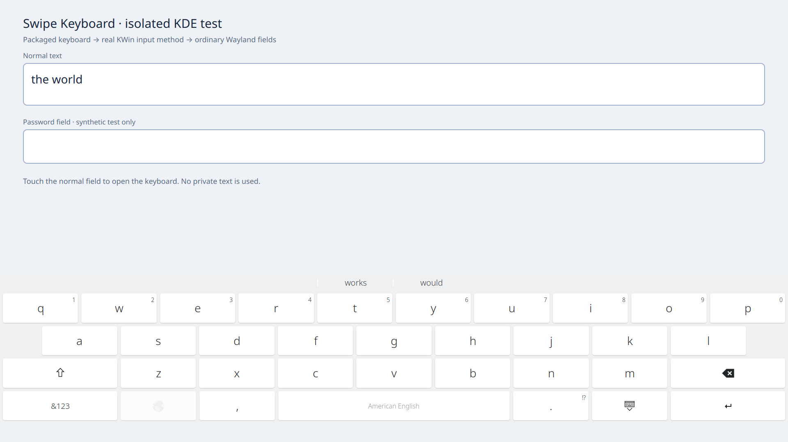

# Swipe Keyboard for KDE Plasma

**English swipe typing for Plasma Keyboard. Powered by FUTO Swipe.**

Swipe across the keys, choose alternative words, and undo a fresh swipe with one Backspace. Uses local recognition models and your existing keyboard's look. **No Z13, ASUS hardware, tablet bundle, theme, agent or YouCoded account required.**

[**Download v0.1.0-r3 test release**](https://github.com/itsdestin/swipe-keyboard/releases/tag/v0.1.0-r3) · [Report a bug](https://github.com/itsdestin/swipe-keyboard/issues/new?template=bug.yml) · [Contribute](CONTRIBUTING.md)

**Safety and compatibility update:** use the `0.1.0-3` packages in **v0.1.0-r3**, not the older v0.1.0 downloads. This revision fixes stale swipes across focus/password changes, tightens selection safeguards, and supports older build baselines plus newer compatible libraries without copying the build machine's package versions into your requirements. See the [tested runtime matrix](docs/revision3-verification.md).



*Fedora KDE test VM; synthetic text only. The keyboard follows your system theme.*

## What it does

- English (US) swipe typing with word alternatives and normal tapping.
- One-shot whole-word Backspace immediately after a swipe or alternative choice, when exact field context is available. After typing or a reported cursor move, Backspace returns to normal. It never guesses a multi-character deletion from hidden/changed/selected or sensitive text.
- Stock Plasma layout and theme retained; no changes to panels, gestures, tablet mode, rotation or wallpaper.
- Reversible per-user activation; later manual keyboard choices are preserved on disable.
- Recognition runs locally. Recording is **off by default**.

## Supported test-release targets

| Package | Verified build/runtime coverage |
|---|---|
| Arch / CachyOS, x86_64 | Built with Plasma Keyboard 6.7.2, Qt 6.11.1, Frameworks 6.27; the **same archive** passed on current Arch with Keyboard 6.8.0, Qt 6.12.0, Frameworks 6.31. The exact package also installed/activated on CachyOS with Qt 6.12 / Frameworks 6.30, without an OS update; installed payload and live system-plugin loading were verified. |
| Fedora 44 KDE, x86_64 | Plasma Keyboard 6.7.5, Qt 6.11.2; native package and real KDE touchscreen acceptance. |

Requires **native Plasma Keyboard 6.7/6.8 in KDE Plasma Wayland**, a touchscreen, **Qt 6.11 or newer within Qt 6** and **glibc 2.43 or newer**—not Maliit or just the Qt Virtual Keyboard libraries. Qt 6.11 and 6.12 are the tested runtime minors. Activation requires an eager native-plugin load to succeed before changing settings; genuine missing libraries/symbols refuse safely. These are actual ABI requirements, not a demand to match every package revision on the build machine. X11, non-KDE, ARM and non-English swipe support are not claimed.

Both native packages, extracted-keyboard loading, installation and removal were checked in isolated distro environments. A full Fedora KDE VM additionally exercised real touchscreen typing, word alternatives/backspace, password safeguards and interrupted-gesture recovery. Reinstall, reboot and restoration/removal acceptance are recorded for the safety candidate; the final compatibility RPM was also installed/restarted and checked in that VM. Arch container/loading tests are not a full Arch desktop or physical-hardware test. This is a **test release**, not a universal hardware/application guarantee. See [revision-3 results](docs/revision3-verification.md) and [earlier safety acceptance](docs/pre-reddit-verification.md).

## Install

1. Download the package matching your distribution from the [release page](https://github.com/itsdestin/swipe-keyboard/releases/tag/v0.1.0-r3). Optionally download `SHA256SUMS.txt` and check the files with `sha256sum --check --ignore-missing SHA256SUMS.txt`.
2. Install the local package:

   **Arch / CachyOS**
   ```sh
   sudo pacman -U ./swipe-keyboard-0.1.0-3-x86_64.pkg.tar.zst
   ```

   **Fedora 44 KDE**
   ```sh
   sudo dnf install ./swipe-keyboard-0.1.0-3.fc44.x86_64.rpm
   ```

3. As your **normal logged-in KDE user**, not sudo:
   ```sh
   swipe-keyboard check
   swipe-keyboard enable
   ```
4. Touch a normal text field to open Plasma Keyboard. Check the language label on the spacebar: **American English / English (US)**. If another language is selected, use the keyboard's globe/language key to switch.
5. Swipe `the`, then `world`; choose a word alternative and try the first on-screen Backspace. Ordinary tapping should still work. [Troubleshooting](#troubleshooting) separates activation problems from recognition/app problems.

The package includes compiled code, models and a dictionary. You do not need a compiler, a Python environment setup or a training-corpus download. **Do not upgrade your whole desktop merely to match the build machine's library revisions.** Check whether you already have a supported native Plasma Keyboard and meet the actual package ABI requirements. An old distro image without that keyboard is a different prerequisite problem; this extension does not install or upgrade the desktop stack for you.

**Already using custom Plasma keyboard layouts?** Setup refuses to overwrite `~/.local/share/plasma/keyboard/layouts` (or its XDG equivalent). Migrate that setup explicitly first; do not stack this over touch-profile's existing keyboard overlay.

## Updates and removal

Install a newer **matching native package** normally. At keyboard startup the private English overlay is rebuilt from the installed stock layouts. Unknown layout formats or incompatible versions fail closed, with a stock-keyboard fallback where possible.

Before removing the package, run as your normal KDE user:

```sh
swipe-keyboard disable
```

Then remove it with `sudo pacman -R swipe-keyboard` or `sudo dnf remove swipe-keyboard`. Original settings still owned by setup are restored; later manual choices are preserved. Personal opt-in recordings/options are not silently deleted.

There is **no public AUR/COPR package repository or automatic update feed yet**; GitHub releases are the download source.

### Desktop upgrades

The supported keyboard series remain **6.7.x/6.8.x**. The original public packages require an exact Qt-minor match; revision 3 is designed for older-build → newer-runtime compatibility within Qt 6, with a real loader check instead of fabricated library-version floors. A runtime older than the build baseline or a missing required ABI still needs a genuinely compatible build—not forced dependencies. Run `swipe-keyboard check` for the specific failure. A future Plasma Keyboard 6.9 upgrade may still conflict with the currently verified series limit; disable/remove the extension first if no compatible release is available. Do not downgrade individual desktop libraries or bypass the package manager.

### Already removed the package without disabling?

KDE may still point to the removed Swipe Keyboard launcher. Reinstall a compatible package, run `swipe-keyboard disable` **as the same user who enabled it**, then remove the package again. The per-user restoration record survives ordinary package removal. If reinstalling is blocked by a desktop upgrade, use **System Settings → Virtual Keyboard** (or search Settings for “Virtual Keyboard”) to select the stock **Plasma Keyboard**, not Swipe Keyboard. That restores a usable keyboard but does not automatically reconstruct all your previous settings. Preserve `~/.local/share/swipe-keyboard/setup-state.json` (or its XDG equivalent) for assisted recovery; do not delete it or guess values.

## Troubleshooting

| Symptom | First checks |
|---|---|
| Keyboard never appears | Run enable in a terminal **inside your logged-in KDE Wayland desktop**, without sudo. Touch a text field rather than clicking with a mouse. Check System Settings → Virtual Keyboard. Test another native Wayland app; this extension does not fix every app's text-input support. |
| Keyboard appears, but only taps work | Run `swipe-keyboard check`; confirm the English language label and matching Qt/Plasma versions. A failed startup check deliberately falls back to stock typing. Reinstall a matching package if files are damaged. |
| Works in one app, not another | Report the app/version and whether it is a native package or Flatpak. Do not change global Qt/input-method environment variables as a first workaround. |
| Existing custom layouts detected | Nothing was overwritten. Preserve your custom layouts and arrange an explicit migration; do not blindly delete the folder or stack overlays. |
| Word alternatives/whole-word undo do nothing | Selections, cursor changes, sensitive fields and missing field context intentionally prevent multi-character edits. Try again in a normal field with no selection. |
| Error during disable | Keep the setup record and exact error. Retry from the original user's desktop; do not run sudo, delete the record or force-reset unrelated keyboard settings. |

**Agent assistance is welcome.** If an error is unfamiliar, you can ask an AI coding agent—such as [YouCoded](https://youcoded.ai)—to inspect the error and guide setup/recovery. It is optional; [GitHub Issues](https://github.com/itsdestin/swipe-keyboard/issues) remains available without an agent. Start with the guide, the exact error, distribution and version information. Ask it to diagnose before changing settings, preserve existing custom layouts/restoration records, and avoid forcing dependencies. Never share typed text, recordings, credentials or unreviewed logs. The maintainer also makes YouCoded.

Since package revision 2, `swipe-keyboard check` prints a read-only support summary (package, Plasma Keyboard/Qt versions, session and current selection). Revision 3 also validates native-library loading before changing settings. Neither proves touchscreen or application compatibility. The original public `0.1.0-1` prints only a short pass/fail message.

## Known v1 limits

- **Firefox physical Ctrl+A/Delete:** the browser/input-method chain can leave field context stale; the next swipe may insert an unwanted leading space. This is a documented minor v1 issue, not a solved upstream bug.
- Apps that hide or misreport text cannot guarantee automatic word deletion or candidate replacement. Normal deletion is the conservative fallback, but an edit never reported by an app cannot be detected reliably. Field context can also be briefly incomplete during initial focus/keyboard startup, temporarily causing ordinary character deletion rather than whole-word undo.
- Application Wayland text-input support affects when the keyboard appears. Not every application's keyboard-summoning behavior is fixed by this extension.
- English swipe recognition only. The base release excludes optional neural/n-gram ranking and training/evaluation data.

[Open a bug report](https://github.com/itsdestin/swipe-keyboard/issues/new?template=bug.yml) with the package version, distribution, Plasma Keyboard/Qt versions, keyboard layout, affected app and a synthetic reproduction phrase. **Do not attach typing recordings, learned words, credentials or unredacted logs.**

## Privacy

Package code/models live under `/usr/share/swipe-keyboard/`. Per-user state and private overlays live under `$XDG_DATA_HOME/swipe-keyboard/`, normally `~/.local/share/swipe-keyboard/`.

Recording requires a user-created `record` switch file and can contain typed words/context; it is intended for explicit local development, not support-log collection. Recordings are owner-only, and password/sensitive-field hints are checked. No recordings are included in release files.

## Development and source

See [CONTRIBUTING.md](CONTRIBUTING.md). Code, engine benchmarks, tests and native package recipes are in this repository. The legacy `./install.sh` is retained for the original touch-profile **developer** setup; it is not the standalone end-user installer.

For complete corresponding source, use the release's **`swipe-keyboard-0.1.0.tar.gz`**, which includes the recursive upstream dependencies. GitHub's automatic “Source code” ZIP/tar links do **not** include Git submodules. Alternatively clone with `git clone --recurse-submodules https://github.com/itsdestin/swipe-keyboard.git`.

The checked-in scoreboard records around 93.32% first-guess accuracy on its 2,000-swipe benchmark, not a guarantee about anyone's typing. Compare changes on the same held-out dataset/configuration rather than treating different benchmarks as equivalent.

## Credits and licenses

**Powered by FUTO Swipe.** [FUTO's swipe-library](https://gitlab.futo.org/keyboard/swipe-library) is GPL-3.0; the model weights have the separate **FUTO Model Weights License 1.0**, distributed alongside them. Preserve the upstream notices and provide corresponding source with GPL binaries. The benchmark dataset is MIT-licensed.

The English dictionary combines AOSP US English word lists (Apache-2.0) and Robyn Speer's [wordfreq](https://github.com/rspeer/wordfreq) frequency data (CC-BY-SA 4.0). The generated dictionary is CC-BY-SA 4.0; attribution/source/checksum details are in [NOTICE](packaging/NOTICE) and the installed licenses. Stock Qt/KDE layouts retain their notices. Optional development models have their own licenses and are not part of the base release merely because the code is GPL.

This project is not endorsed by FUTO, KDE, Google or ASUS. It was built and refined with [YouCoded](https://youcoded.ai); the maintainer also makes YouCoded. Using or contributing to this keyboard does not require it.
